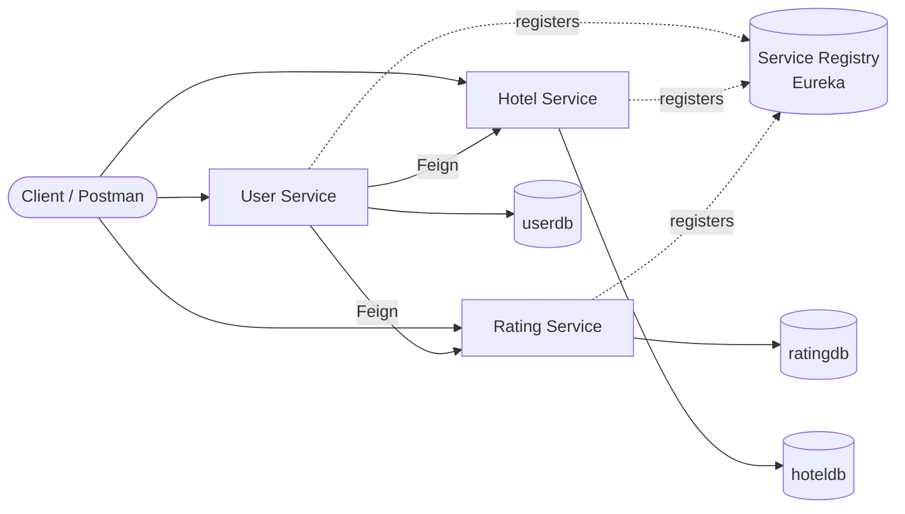
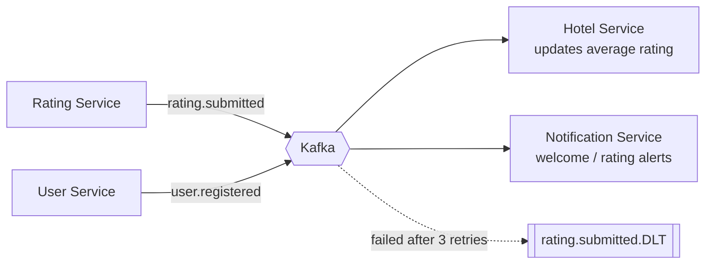

# Hotel Management Platform (Microservices)

A hotel management backend built with **Spring Boot microservices**. Guests can register, rate hotels, and view a combined profile of their ratings and the hotels they rated. Services discover each other through **Eureka** and communicate through **OpenFeign**. **Apache Kafka** event streaming is in progress (see [Roadmap](#roadmap)).


---

## Table of Contents

1. [Architecture](#architecture)
2. [Services](#services)
3. [Tech Stack](#tech-stack)
4. [Getting Started](#getting-started)
5. [API Reference](#api-reference)
6. [Sample Requests](#sample-requests)
7. [Design Decisions](#design-decisions)
8. [Roadmap](#roadmap)
9. [Project Structure](#project-structure)

---

## Architecture

### Current



Each service owns its own database. No service reads another service's tables.

### Planned (Kafka event flow)



---

## Services

| Service | Responsibility | Status |
|---|---|---|
| **Service Registry** | Eureka server; lets services find each other by name | Done |
| **User Service** | Guest registration, and combined profile (user + ratings + hotels) | Done |
| **Hotel Service** | Hotel catalogue | Done |
| **Rating Service** | Ratings given by guests | Done |
| **Notification Service** | Reacts to Kafka events | Planned |
| **API Gateway** | Single entry point | Planned |

---

## Tech Stack

- **Language:** Java 11
- **Framework:** Spring Boot 2.7.5, Spring Data JPA, Spring Validation
- **Microservices:** Spring Cloud Netflix Eureka, Spring Cloud OpenFeign
- **Database:** MySQL (one database per service)
- **Build:** Maven
- **Messaging (in progress):** Apache Kafka
- **Planned:** Spring Cloud Gateway, Docker Compose, Swagger/OpenAPI

---

## Getting Started

### Prerequisites

- JDK 11
- Maven 3.8+
- MySQL 8 running locally

### 1. Clone

```bash
git clone https://github.com/legend743/micro_service_project.git
cd micro_service_project
```

### 2. Create the databases

```sql
CREATE DATABASE userdb;
CREATE DATABASE hoteldb;
CREATE DATABASE ratingdb;
```

Tables are created automatically by Hibernate (`ddl-auto=update`).

### 3. Configure credentials

Each service reads database credentials from environment variables, with a fallback for local use:

```properties
spring.datasource.username=${DB_USER:root}
spring.datasource.password=${DB_PASSWORD:}
```

Set them before starting:

```bash
# Windows PowerShell
$env:DB_USER="root"; $env:DB_PASSWORD="your_password"

# Linux / macOS
export DB_USER=root DB_PASSWORD=your_password
```

### 4. Start the services in this order

| Order | Service | Command | Default port |
|---|---|---|---|
| 1 | Service Registry | `mvn spring-boot:run` | 8761 |
| 2 | Rating Service | `mvn spring-boot:run` | 8082 |
| 3 | Hotel Service | `mvn spring-boot:run` | 8083 |
| 4 | User Service | `mvn spring-boot:run` | 8081 |

Run each command from inside that service's folder. Registry first, because the others register with it on startup.

### 5. Verify

Open the Eureka dashboard at **http://localhost:8761**. All three services should appear under *Instances currently registered*.

---

## API Reference

### User Service (`/userdetails`)

| Method | Endpoint | Description |
|---|---|---|
| POST | `/userdetails/add` | Register a guest |
| GET | `/userdetails/getuser/{id}` | Guest profile with ratings and hotel details |
| GET | `/userdetails/getallusers` | List all guests |

### Hotel Service (`/hoteldetails`)

| Method | Endpoint | Description |
|---|---|---|
| POST | `/hoteldetails/addhotel` | Add a hotel |
| GET | `/hoteldetails/getallhotels` | List all hotels |
| GET | `/hoteldetails/gethotels/{id}` | Get one hotel |

### Rating Service (`/hotelrating`)

| Method | Endpoint | Description |
|---|---|---|
| POST | `/hotelrating` | Submit a rating |
| GET | `/hotelrating/getallhotelrating` | List all ratings |
| GET | `/hotelrating/getbyusers/{userId}` | Ratings given by one guest |
| GET | `/hotelrating/getByRatingId/{ratingId}` | One rating by its ID |

### Error format

All errors return the same JSON shape:

```json
{
  "timestamp": "2026-11-01T19:30:12.123",
  "status": 404,
  "message": "User not found: abc-123",
  "path": "/userdetails/getuser/abc-123"
}
```

| Status | Meaning |
|---|---|
| 400 | Invalid input (for example, bad email format) |
| 404 | Resource not found |
| 409 | Duplicate resource (for example, email already registered) |

---

## Sample Requests

**Register a guest**

```bash
curl -X POST http://localhost:8081/userdetails/add \
  -H "Content-Type: application/json" \
  -d '{"name":"Ravi Kumar","email":"ravi@example.com","about":"Business traveller"}'
```

**Add a hotel**

```bash
curl -X POST http://localhost:8083/hoteldetails/addhotel \
  -H "Content-Type: application/json" \
  -d '{"hotelName":"StayEasy Lucknow","location":"Lucknow"}'
```

**Submit a rating**

```bash
curl -X POST http://localhost:8082/hotelrating \
  -H "Content-Type: application/json" \
  -d '{"userId":"<user-id>","hotelId":1,"rating":4,"feedback":"Clean rooms, friendly staff"}'
```

**Get a guest profile** (calls Rating Service and Hotel Service through Feign)

```bash
curl http://localhost:8081/userdetails/getuser/<user-id>
```

Example response:

```json
{
  "user": {
    "userId": "b7c1...",
    "name": "Ravi Kumar",
    "email": "ravi@example.com",
    "about": "Business traveller"
  },
  "ratings": [
    {
      "ratingId": 1,
      "hotelId": 1,
      "rating": 4,
      "feedback": "Clean rooms, friendly staff",
      "hotel": { "id": 1, "hotelName": "StayEasy Lucknow", "location": "Lucknow" }
    }
  ],
  "message": null
}
```

---

## Design Decisions

- **Database per service.** Services stay independent, and no service reads another's tables.
- **Service discovery with Eureka.** Services call each other by registered name, never by hardcoded host and port.
- **OpenFeign for synchronous reads.** Declarative client interfaces keep inter-service calls readable.
- **Graceful degradation.** If Rating Service or Hotel Service is down, the user profile still returns the guest's basic details with a message, instead of failing the whole request.
- **DTOs separate from entities.** Entities stay inside each service, and only DTOs cross the API boundary.
- **Centralised exception handling.** A `@RestControllerAdvice` returns one consistent error format.
- **Kafka for state changes (planned).** Reads use REST, while events such as a new rating are published to Kafka, so services stay loosely coupled.

---

## Roadmap

- [x] Eureka service registry
- [x] User, Hotel and Rating services with their own databases
- [x] Inter-service calls with OpenFeign
- [x] Validation and global exception handling
- [ ] Kafka via Docker Compose
- [ ] Rating Service publishes `rating.submitted`
- [ ] Hotel Service consumes it and updates average rating and rating count
- [ ] Idempotent consumers, retries and dead-letter topic
- [ ] User Service publishes `user.registered`
- [ ] Notification Service consuming events
- [ ] API Gateway
- [ ] Swagger/OpenAPI documentation
- [ ] Integration test for the rating-to-Kafka flow
- [ ] One-command startup with `docker compose up`

### Planned Kafka topics

| Topic | Producer | Consumers |
|---|---|---|
| `user.registered` | User Service | Notification Service |
| `rating.submitted` | Rating Service | Hotel Service, Notification Service |
| `rating.submitted.DLT` | Hotel Service | Manual review |

---

## Project Structure

```
micro_service_project/
├── ServiceRegistry/        Eureka server
├── UserService/            Guest management and combined profile
├── hotel_microservices/    Hotel catalogue
├── hotelrating/            Ratings
└── README.md
```

Each service follows the same layout:

```
controller/   REST endpoints
service/      business logic
repository/   Spring Data JPA
entity/       database models
dto/          request and response objects
client/       Feign clients (User Service)
exception/    custom exceptions and global handler
```

---

## Author

**legend743**
GitHub: [@legend743](https://github.com/legend743)
